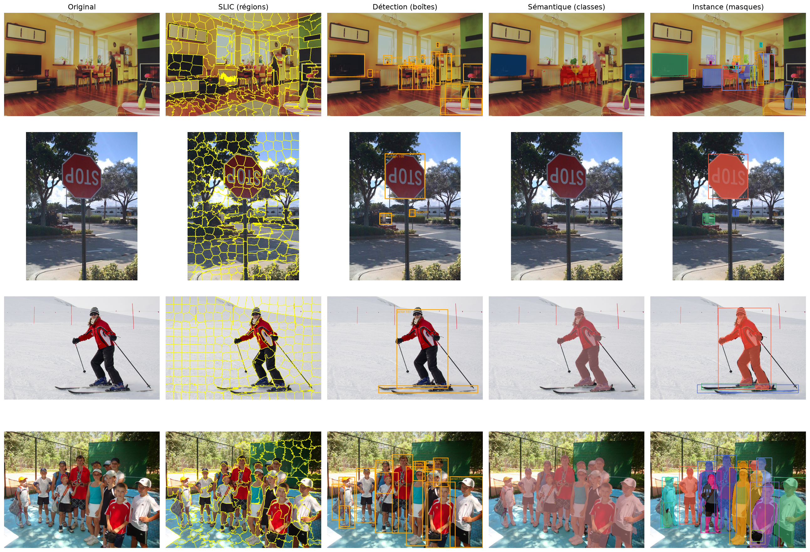
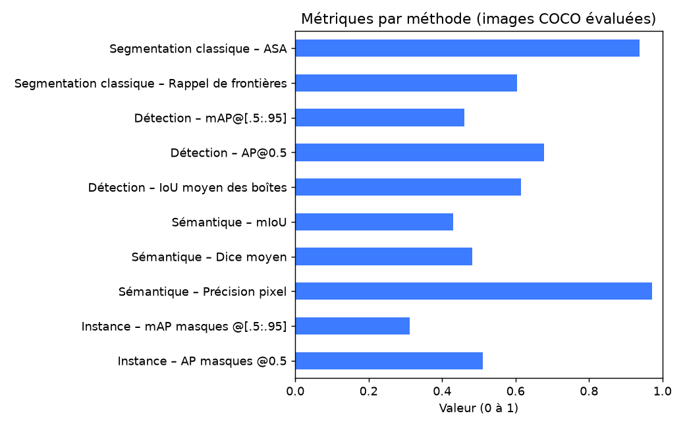

# Segmentation d'images, détection d'objets, segmentation sémantique et d'instance

Comparaison de **quatre méthodes** sur un **même jeu d'images**, avec évaluation chiffrée contre les annotations COCO.

| # | Méthode | Modèle / algorithme | Question posée | Sortie |
|---|---|---|---|---|
| 1 | Segmentation classique | k-means, SLIC | Quels pixels se ressemblent ? | Régions sans classe |
| 2 | Détection d'objets | Faster R-CNN (ResNet-50 FPN) | Quoi et où ? | Boîtes + classe + score |
| 3 | Segmentation sémantique | DeepLabV3 (ResNet-50) | Quelle classe par pixel ? | Carte de classes |
| 4 | Segmentation d'instance | Mask R-CNN (ResNet-50 FPN) | Quel objet, quels pixels ? | Un masque par objet |

Fonctionnement **100 % local** : les poids pré-entraînés (~160 Mo par modèle) sont téléchargés une fois par `torchvision` (cache `~/.cache/torch`). CPU suffisant, GPU utilisé automatiquement s'il existe.

---

## 1. Structure du dépôt

```
.
├── segmentation_methodesFinal.ipynb   # code complet (notebook)
├── requirements.txt                   # dépendances Python
├── README.md                          # cette documentation
├── data/
│   ├── images/                        # images d'entrée (créé automatiquement)
│   └── annotations/                   # annotations COCO (téléchargées automatiquement)
└── outputs/
    ├── comparaison.png                # grille de comparaison des 4 méthodes
    ├── metriques.csv                  # tableau récapitulatif des métriques
    └── metriques.png                  # graphique des métriques
```

## 2. Installation et exécution

```powershell
python -m venv .venv
.\.venv\Scripts\Activate.ps1
pip install -r requirements.txt
jupyter notebook segmentation_methodesFinal.ipynb
```

Puis : **Run All**. Si `data/images/` est vide, 4 images COCO val2017 sont téléchargées automatiquement. Vous pouvez y déposer vos propres images (`.jpg` / `.png`).

> Pour l'évaluation (section 11), les images doivent s'appeler `coco_<id>.jpg` (vérité terrain COCO). Les autres images sont ignorées dans cette section. Les annotations (~241 Mo) sont téléchargées une seule fois.

---

## 3. Documentation du code

### Paramètres globaux (section 3)

| Constante | Valeur | Rôle |
|---|---|---|
| `DATA_DIR` | `data/images` | Dossier des images d'entrée |
| `COCO_IDS` | 4 identifiants | Images COCO téléchargées par défaut |
| `MAX_SIDE` | 640 | Côté maximal (px) après réduction, pour accélérer les modèles |
| `MAX_IMAGES` | 4 | Nombre d'images traitées |

### Fonctions utilitaires

| Fonction | Rôle |
|---|---|
| `list_images()` | Liste les images `.jpg/.jpeg/.png` de `DATA_DIR` |
| `download_samples()` | Télécharge les 4 images COCO si le dossier est vide |
| `load(path)` | Ouvre une image en RGB et la réduit à `MAX_SIDE` |
| `show(imgs, titles, ncols, size)` | Affiche une liste d'images en grille (matplotlib) |

### Méthode 1 — Segmentation classique (section 4)

| Fonction | Principe | Paramètres clés |
|---|---|---|
| `seg_kmeans(img, k=5, n_fit=20000)` | k-means sur la couleur RGB : chaque pixel prend la couleur de son centre. L'apprentissage se fait sur un échantillon de 20 000 pixels, la prédiction sur tous. | `k` = nombre de couleurs |
| `seg_slic(img, n_segments=250)` | Superpixels SLIC (régions compactes suivant les contours) ; retourne les labels et l'image avec frontières. | `n_segments`, `compactness=10` |

Aucune notion de classe : on obtient des régions homogènes.

### Méthode 2 — Détection d'objets (section 6)

| Élément | Rôle |
|---|---|
| `det_model` | Faster R-CNN ResNet-50 FPN pré-entraîné COCO (`FasterRCNN_ResNet50_FPN_Weights.DEFAULT`) |
| `detect(img, thr=0.6)` | Prédit les boîtes et ne garde celles avec un score ≥ `thr` |
| `draw_det(img, res)` | Dessine boîtes, classe et score (`draw_bounding_boxes`) |

### Méthode 3 — Segmentation sémantique (section 7)

| Élément | Rôle |
|---|---|
| `sem_model` | DeepLabV3 ResNet-50, 21 classes Pascal VOC (fond + 20 objets) |
| `voc_cmap()` | Palette de couleurs standard Pascal VOC |
| `segment_semantic(img)` | Prédit une classe par pixel (`argmax`), puis redimensionne à la taille de l'image |
| `overlay_semantic(img, mask, alpha=0.6)` | Superpose les couleurs de classes sur l'image |

Les classes « stuff » (ciel, herbe…) n'existent pas dans VOC : elles tombent dans `background`.

### Méthode 4 — Segmentation d'instance (section 8)

| Élément | Rôle |
|---|---|
| `inst_model` | Mask R-CNN ResNet-50 FPN pré-entraîné COCO |
| `segment_instance(img, thr=0.6)` | Retourne masques binaires `[N,H,W]` (seuil 0,5), boîtes, classes, scores |
| `draw_inst(img, res)` | Colorie chaque masque d'une couleur propre, avec sa boîte |

### Comparaison et cohérence (sections 9 et 10)

- **Section 9** : grille *Original / SLIC / Détection / Sémantique / Instance*, enregistrée dans `outputs/comparaison.png`.
- **Section 10** : sans vérité terrain, comparaison sur la classe *person* : nombre de personnes (détection vs instance), % de pixels « person » (sémantique), et `iou(a, b)` entre le masque sémantique et l'union des masques d'instance.

### Évaluation avec vérité terrain COCO (section 11)

| Fonction | Rôle |
|---|---|
| `gt_size(img_id)` | Taille d'origine (largeur, hauteur) de l'image COCO |
| `resize_mask(m, size)` | Redimensionnement « plus proche voisin » d'une carte d'entiers (sans interpolation) |
| `gt_semantic(img_id)` | Vérité terrain sémantique : carte de classes VOC (via `COCO_TO_VOC`) |
| `gt_instances_map(img_id)` | Vérité terrain d'instance : un identifiant par objet annoté |
| `asa(labels, gt)` | *Achievable Segmentation Accuracy* : chaque superpixel prend le segment réel majoritaire |
| `boundary_recall(labels, gt, tol=2)` | Part des contours réels retrouvés à ± 2 px |
| `box_iou_np(a, b)` | IoU entre toutes les paires de boîtes |
| `run_coco_eval(results, iou_type)` | Évaluation officielle COCO (`pycocotools`) : mAP boîtes (`bbox`) ou masques (`segm`) |
| `confusion(gt, pred, n)` | Matrice de confusion classe réelle × classe prédite |

### Métriques utilisées

| Méthode | Métriques | Définition |
|---|---|---|
| SLIC | ASA, rappel de frontières | Qualité du respect des contours réels |
| Détection | IoU, AP / mAP | IoU = surface commune / surface réunie ; mAP moyenné sur IoU 0,5 → 0,95 |
| Sémantique | IoU par classe, mIoU, Dice | IoU = TP/(TP+FP+FN) ; Dice = 2·TP/(2·TP+FP+FN) |
| Instance | mAP des masques | Comme la détection, IoU calculé sur les masques |

Pour le mAP, les prédictions sont gardées dès un score de **0,05** (au lieu de 0,6) afin de tracer la courbe précision-rappel.

---

## 4. Résultats





Le tableau complet est dans `outputs/metriques.csv`.

> Avec seulement 4 images, les chiffres sont **indicatifs** : augmenter `MAX_IMAGES` pour plus de fiabilité.

## 5. À retenir

| Méthode | Granularité | Distingue les individus ? | Donne la classe ? |
|---|---|---|---|
| Segmentation classique | Région de pixels | Non | Non |
| Détection | Boîte | Oui | Oui |
| Sémantique | Pixel | Non | Oui |
| Instance | Pixel | Oui | Oui |

## 6. Pistes d'amélioration

- Remplacer Faster R-CNN par YOLO (`ultralytics`) pour la détection et l'instance.
- Fine-tuner un modèle sur des images annotées propres.
- Évaluer sur davantage d'images COCO.